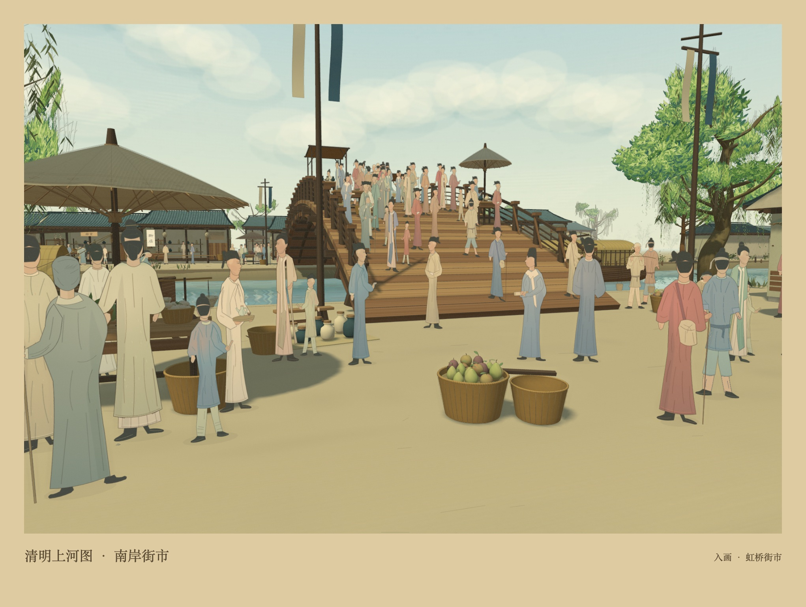
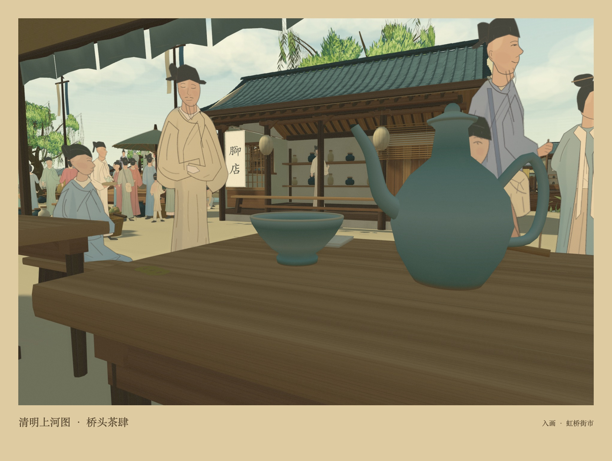
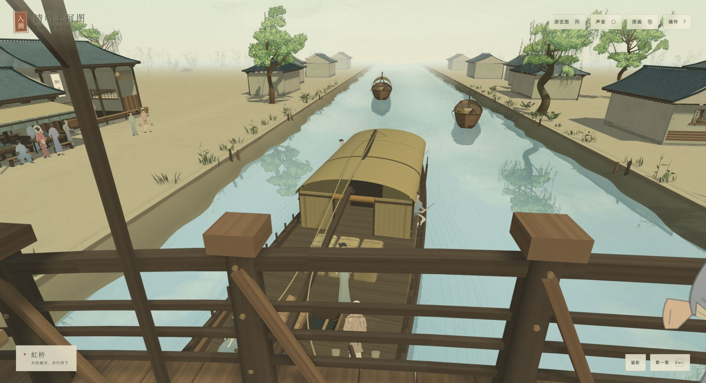

<div align="center">

# 入画 · 清明上河图

**循汴河，入画中。**

以张择端笔下的虹桥街市为起点，在温暖的手绘画境里，走近千年前的寻常一日。

**[在线游玩](https://dhs2004.github.io/qingming-riverside/)** · **[玩法说明](#怎么玩)** · **[本地运行](#本地运行)** · **[部署指南](#部署到线上)**

无需登录 · 无需安装客户端 · 支持键鼠与触屏

[](https://github.com/Dhs2004/qingming-riverside/actions/workflows/pages.yml)

</div>



## 关于入画

**入画**是一个在浏览器中运行的第一视角探索体验。它以故宫博物院藏、北宋张择端《清明上河图》的虹桥一段为参考，把木桥、汴河、舟船与沿岸街市组织成一处可以连续步行的空间。

你可以沿摊铺慢行，走上虹桥看桥下的舟船；也可以在茶肆檐下坐一会，看人群从眼前走过。细墨线、淡绢纹与温暖的手绘动画光色贯穿场景，近处的茶具、竹篓、船缆和木构则保留了可以停下来看的细节。

当前内容集中在**一处连续的虹桥街区**：南北两岸街市、一座木拱桥、船埠与两间可进入的茶肆。游览图上的四个落脚点都在同一场景里。

## 画境里有什么

| 内容 | 当前版本 |
| --- | --- |
| 市井人物 | 342 位人物、13 类角色、30 组活动；包含长者、僧人、负筐行人、持卷者与俯身劳作者 |
| 街上往来 | 25 位行人沿路线行走，衣色、身高、朝向与动作有所变化 |
| 舟船与禽畜 | 5 艘舟船、12 只动物，以及船工、驴车、货包与缆绳 |
| 摊铺细物 | 陶器、布匹、果蔬、点心、蒸笼、茶具、秤、竹篓和修补过的船篷 |
| 春日光景 | 柳枝、叶簇、芦苇、野花、飞鸟、水面倒影、蒸汽与轻轻摆动的幌子 |
| 交互体验 | 自由漫游、自动导览、地图定位、细节说明、茶肆落座、原画对照与 JPEG 留影 |

<table>
  <tr>
    <td width="50%"></td>
    <td width="50%"></td>
  </tr>
  <tr>
    <td align="center">在茶肆檐下坐一会</td>
    <td align="center">从虹桥看汴河舟船</td>
  </tr>
</table>

*以上均为当前画境的实机画面；带题签的图片由游戏内「留影」功能生成。*

## 怎么玩

打开 **[在线游玩入口](https://dhs2004.github.io/qingming-riverside/)**，等画卷展开后，点击「入画漫游」。想先看一圈，可以选择「循卷游览」自动慢行，中途按行走键或点击「停止游览」即可接管。

### 键鼠与触屏

| 操作 | 键鼠 | 触屏 |
| --- | --- | --- |
| 行走 | `W` / `A` / `S` / `D`；`↑` / `↓` 前后走 | 拖动左下方向盘 |
| 环顾 | 拖动画面；`←` / `→` 转身 | 在画面右侧拖动 |
| 快走 | 按住 `Shift` | — |
| 端详附近细节 | 出现提示后按 `E`，或点击「端详」 | 点击「端详」 |
| 暂停 | `Esc`，或点击「歇一歇」 | 点击「歇一歇」 |
| 关闭说明窗口 | `Esc`，或点击关闭按钮 | 点击关闭按钮 |

### 第一次来，可以这样走

1. **逛南岸街市。** 从入口沿摊铺走向虹桥，看看果蔬、陶器和围着摊位的人。
2. **上桥看船。** 走到桥上，转身看木构、船篷与桥下的船工。也可以打开「游览图」直接前往虹桥。
3. **去茶肆歇脚。** 到南岸茶肆附近，出现提示后「端详」，选择「在檐下坐一会」。点击「起身」、按行走键或拖动方向盘可以站起来。
4. **对照原画。** 点击右上角「原画」，在虹桥、木作、舟楫、街市四组细部之间切换，最高可放大至 3 倍查看。
5. **留下一张画。** 自由漫游时点击「留影」，下载当前视角的 JPEG 图片。导览途中先停止游览，再留影。

「游览图」可前往南岸街市、虹桥、茶肆与船埠。环境音默认关闭，点击「声音」开启；声音由浏览器合成，不需要麦克风权限。

## 本地运行

网站是原生 HTML、CSS 与 JavaScript 模块，运行素材均在 `dist/` 内，Three.js 也随仓库提供。**不需要安装 npm 依赖、配置 API 密钥或启动后端。**

准备好 Git 和 Python 3，然后执行：

```sh
git clone https://github.com/Dhs2004/qingming-riverside.git
cd qingming-riverside
python3 -m http.server 18742 --bind 127.0.0.1 --directory dist
```

打开 **<http://127.0.0.1:18742/>**。结束时在终端按 `Ctrl+C`。

Windows 若没有 `python3` 命令，可将最后一行替换为：

```powershell
py -3 -m http.server 18742 --bind 127.0.0.1 --directory dist
```

同时装有 Node.js 与 Python 3 时，也可以用 `npm run dev` 启动同一个本地服务。`npm run dev` 内部仍调用 `python3`。

> 请通过 HTTP 服务打开项目。直接双击 `dist/index.html` 使用 `file://` 访问时，浏览器会限制 JavaScript 模块加载。

## 部署到线上

### 本仓库：GitHub Pages 自动发布

线上地址：**https://dhs2004.github.io/qingming-riverside/**

推送到 `main` 后，[GitHub Actions](https://github.com/Dhs2004/qingming-riverside/actions/workflows/pages.yml) 会先执行语法与场景检查，成功后将 `dist/` 发布到 GitHub Pages。Pull Request 只执行检查；也可以在 Actions 中选择工作流，点击 **Run workflow** 手动发布。

部署配置见 [`.github/workflows/pages.yml`](.github/workflows/pages.yml)。

### 部署自己的副本

1. Fork 本仓库，在副本的 **Actions** 页面启用工作流。
2. 打开 **Settings → Pages → Build and deployment**，将 **Source** 设为 **GitHub Actions**。
3. 在 Actions 中运行 **Check and deploy GitHub Pages** 工作流，或向 `main` 推送一次提交。
4. 等待 `check` 和 `deploy` 都成功，从 **Settings → Pages** 查看实际网址，并更新 README 中的游玩链接和状态徽章。

也可使用其他静态托管服务：将 **`dist/` 的内容**作为站点根目录上传，保留文件之间的相对路径。无需构建命令，发布目录为 `dist`。

## 开发与检查

建议使用 Node.js 22，与当前 CI 配置保持一致。以下检查不需要 `npm install`：

```sh
npm run check
npm run check:world
```

| 命令 | 检查内容 |
| --- | --- |
| `npm run check` | 场景 JavaScript 文件的语法 |
| `npm run check:world` | 几何数据、桥面高度、碰撞、出生点、导览与行人路线，以及四处地标和两间茶肆的可达性 |

场景检查在 Node.js 中使用模拟画布运行。它能发现结构与路线问题；人物绘制、材质、光影和交互仍需在浏览器中实际查看。

### 技术与目录

渲染基于 **Three.js r169 / WebGL 2**；建筑、器物、植被及绘制素材由程序生成。人物和动物采用多角度平面绘画，配合转向与步态动画；场景使用静态几何合批，触屏布局会降低阴影与倒影缓冲区的分辨率。

| 路径 | 用途 |
| --- | --- |
| [`dist/index.html`](dist/index.html)、[`dist/style.css`](dist/style.css) | 中文界面、响应式布局与面板 |
| [`dist/main.js`](dist/main.js) | 相机、输入、交互、声音、导览、原画对照与留影 |
| [`dist/world.js`](dist/world.js) | 桥、建筑、街市、舟船布置与碰撞 |
| [`dist/ink.js`](dist/ink.js) | 几何、笔线、材质与静态合批工具 |
| [`dist/people.js`](dist/people.js)、[`townsfolk.js`](dist/townsfolk.js)、[`tableaux.js`](dist/tableaux.js)、[`animals.js`](dist/animals.js) | 人物、生活姿态与动物绘制 |
| [`dist/crowd-life.js`](dist/crowd-life.js)、[`crowd-paths.js`](dist/crowd-paths.js)、[`crowd-shadows.js`](dist/crowd-shadows.js) | 人群分组、行走路径与脚下阴影 |
| [`dist/atmosphere.js`](dist/atmosphere.js)、[`garden.js`](dist/garden.js) | 天空、倒影、蒸汽、植物与微风 |
| `dist/*-craft.js`、[`dist/artisan.js`](dist/artisan.js)、[`market-goods.js`](dist/market-goods.js) | 木作、船具、灯笼、茶点与摊铺细物 |
| [`dist/assets/`](dist/assets/) | Three.js、第三方许可、原画对照图及纹理 |
| [`tools/check-world.mjs`](tools/check-world.mjs) | 场景结构与路线检查 |
| [`research/`](research/) | 参考笔记与纹理制作脚本；原始大图需按笔记中的来源另行获取 |
| [`docs/`](docs/) | README 使用的实机图片 |

## 常见问题

<details>
<summary>账号、费用与权限</summary>

直接打开公开网址即可游玩，无需账号、API 密钥或订阅。画境不设置统计追踪，也不需要摄像头或麦克风权限。

</details>

<details>
<summary>手机与浏览器支持</summary>

提供触屏方向盘和拖动环顾。请使用支持 WebGL 2 的现代浏览器；场景包含较多绘制素材与几何，首次载入时间和帧率取决于设备性能。

</details>

<details>
<summary>黑屏或提示「画境暂未展开」</summary>

先确认通过 HTTP/HTTPS 访问，再检查浏览器是否支持 WebGL 2、图形加速是否可用。可以更新浏览器后重试。

</details>

<details>
<summary>开启环境音</summary>

环境音默认关闭，需要点击右上角「声音」。同时检查设备音量与标签页是否静音。

</details>

<details>
<summary>当前可探索范围</summary>

当前只制作虹桥附近的一段连续街区。可以从多个落脚点探索，并在原画对照中查看相应细部。

</details>

## 原画依据与素材说明

主要依据为**故宫博物院藏、北宋张择端本《清明上河图》**。原画采用散点透视，无法直接对应唯一的三维空间；本项目补充了建筑背面、尺度、通行路线、摊位细物和人物动作。春叶、柔光、倒影与动画感设色也是此次画境的艺术演绎。

人物和动物是前、后及两侧的平面绘画，在三维场景中转向；近距离绕看仍可察觉平面形态。原画扫描经过发布者调色，采样纹理也经过裁切、灰度化与平铺处理，不能作为原作精确色样。

| 参考或依赖 | 来源与说明 |
| --- | --- |
| 作品信息 | [故宫博物院藏品页](https://www.dpm.org.cn/collection/paint/228226.html)、[故宫名画记](https://minghuaji.dpm.org.cn/paint/detail?id=592d80e225aac624977fee2e19452c1f) |
| 原画扫描 | Wikimedia Commons 的[全卷扫描](https://commons.wikimedia.org/wiki/File:Alongtheriver_QingMing.jpg)与[虹桥细部](https://commons.wikimedia.org/wiki/File:Along_the_River_During_the_Qingming_Festival_%28detail_of_original%29.jpg)，页面标注 PD-Art / 公共领域 |
| 渲染库 | Three.js r169，MIT 许可全文见 [`THREE-LICENSE.txt`](dist/assets/THREE-LICENSE.txt) |

更多采样来源、制作观察和重构边界见 [参考笔记](research/reference-notes.txt) 与 [游戏内参考说明](https://dhs2004.github.io/qingming-riverside/sources.html)。项目与故宫博物院没有隶属或授权关系，未使用电影画面、角色或配乐。第三方素材的许可仅适用于对应素材；本仓库目前未单独声明项目整体的软件许可证。

## 反馈

欢迎通过 [Issues](https://github.com/Dhs2004/qingming-riverside/issues) 提交问题或建议。遇到显示、性能或行走问题时，请附上浏览器与设备信息、所在位置、复现步骤，以及方便提供的截图。

---

**[沿着汴河，回到画中 →](https://dhs2004.github.io/qingming-riverside/)**
